# Visual Tour of AI Foundations

<!-- Generated by tools/build_visual_tour.py from syllabus.md and the-diagram-atlas.md - do not edit here; edit those and rebuild. -->

Every topic in the course, in order, with the famous diagrams beside the topics that teach them. Each diagram is annotated with its image search, the exact PDF page of its primary figure where there is one, and notes on how to read it. For the reading method and the five grammars, see [`the-diagram-atlas.md`](the-diagram-atlas.md).

## Phase 0 — Orientation

**0.1** What AI / ML / deep learning actually are (no math). Where LLMs, image generators fit. What we'll build toward.

**0.2** Set up tools: Python, a code editor, install PyTorch, run "hello tensor".

**0.3** Python crash-start I: variables, numbers, strings, lists, printing.

**0.4** Python crash-start II: functions, loops, `if`, importing libraries.

## Phase 1 — The Core Idea of Learning from Data

**1.1** What a "model" is: input → prediction. Data, features, labels.

**1.2** Math intuition: a number line, a vector as a list of numbers, a matrix as a grid.

**1.3** The artificial neuron: weighted sum + bias. Hand-compute one by hand.

### 1.3 Artificial neuron (perceptron)

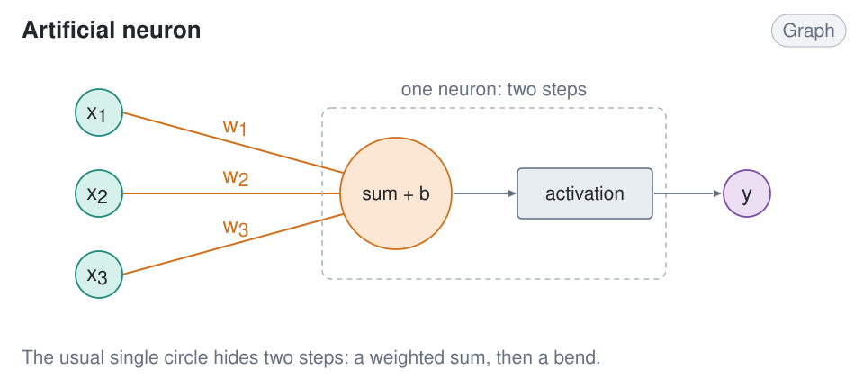

- Image search: [artificial neuron perceptron diagram](https://www.google.com/search?tbm=isch&q=artificial+neuron+perceptron+diagram)

- **Grammar:** Graph
- **Source:** No single origin; the picture is folklore.
- **Read it:** Inputs on the left, each multiplied by its weight; a sum (plus bias); a squashing
  function, which topic 1.4 teaches; one output.
- **Trap:** The one circle hides two steps, the weighted sum and the activation. The side-by-side
  biological neuron is a loose inspiration, not a working model.
- **Check:** With x = (1, 2), w = (0.5, -1), b = 1, what is the weighted sum plus bias? (-0.5.)

```
x1 --w1--\
x2 --w2---( sum + b )--[ activation ]--> y
x3 --w3--/
```

**1.4** Activation functions: why we need a "bend" (ReLU, sigmoid) — intuition.

### 1.4 Activation function curves

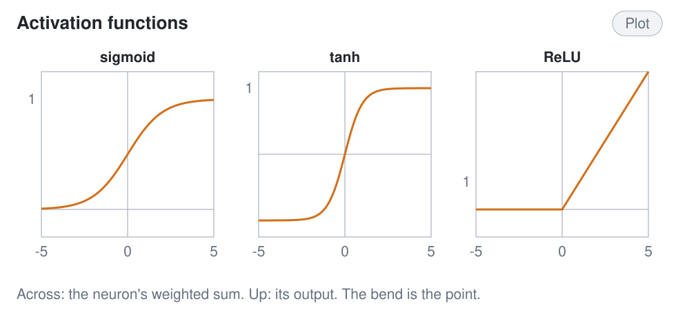

- Image search: [activation functions ReLU sigmoid tanh plot](https://www.google.com/search?tbm=isch&q=activation+functions+ReLU+sigmoid+tanh+plot)

- **Grammar:** Plot
- **Source:** No single origin; these are plots of formulas.
- **Read it:** The horizontal axis is the neuron's weighted sum; the vertical axis is its output.
- **Trap:** The horizontal axis is not time and not the raw input. The bend is the whole point:
  a straight line here would make stacked layers collapse into one.
- **Check:** The neuron in the 1.3 check has a weighted sum plus bias of -0.5. What does ReLU
  output? (0, since ReLU turns negatives into 0.) Where on the sigmoid is the slope nearly zero,
  and what might that do to learning? (Far from 0 on either side; the gradient nearly vanishes.)

```
sigmoid:      ______        ReLU:           /
             /                             /
      ______/                      _______/
```

**1.5** A layer of neurons; stacking layers → the **Multi-Layer Perceptron (MLP)**.

### 1.5 Multi-layer perceptron (MLP, fully connected network)

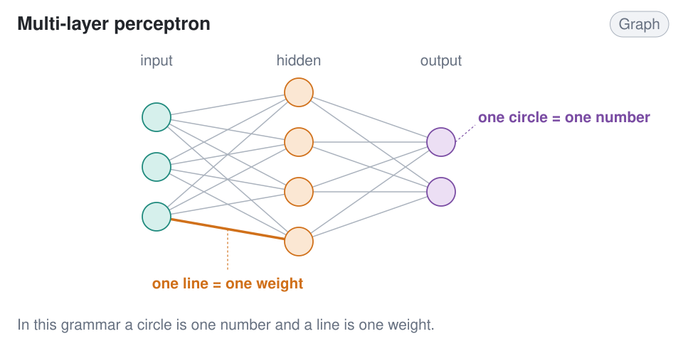

- Image search: [multilayer perceptron fully connected network diagram](https://www.google.com/search?tbm=isch&q=multilayer+perceptron+fully+connected+network+diagram)

- **Grammar:** Graph
- **Source:** Interactive: [TensorFlow Playground](https://playground.tensorflow.org/).
- **Read it:** Columns are layers. Every circle connects to every circle in the next column.
- **Trap:** Each line is one weight, and each circle is one value at run time, not a stored
  object. Authors disagree about whether the input column counts as a layer.
- **Check:** Count the parameters in a 3-4-2 network, biases included. (3*4 + 4*2 = 20 weights,
  plus 4 + 2 = 6 biases, for 26.)

```
input   hidden   output
  o
          o
  o                o
          o
  o                o
          o

(each column is fully connected to the next)
```

**1.6** Universal approximation: a visual proof that one hidden layer can trace any continuous curve (steep sigmoid → step → bump → lookup table), what the theorem promises, what it doesn't, and why we still go deep.

### 1.6 Universal approximation (steps, bumps and curves)

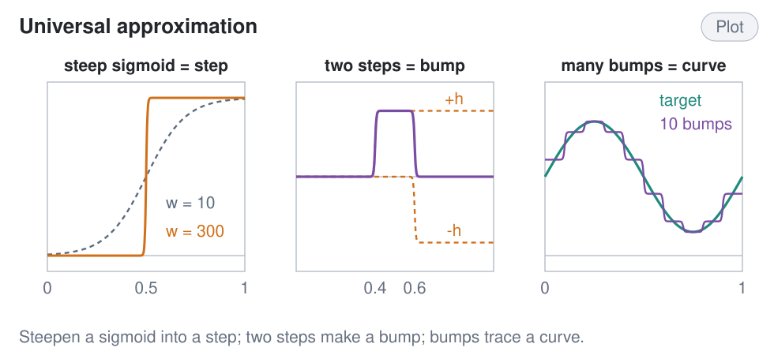

- Image search: [universal approximation theorem neural network bump functions](https://www.google.com/search?tbm=isch&q=universal+approximation+theorem+neural+network+bump+functions)

- **Grammar:** Plot
- **Source:** Nielsen, [A visual proof that neural nets can compute any function](http://neuralnetworksanddeeplearning.com/chap4.html),
  Ch. 4 of *Neural Networks and Deep Learning* (2015), whose sliders are worth playing with. The
  theorems are Cybenko (1989) and Hornik, Stinchcombe & White (1989).
- **Read it:** Left: raising the weight w steepens a sigmoid into a step at x = -b/w. Middle: a
  step up and a step down, joined by output weights +h and -h, make a bump of height h. Right:
  bumps side by side trace a target curve, and more neurons give narrower bumps and a closer fit.
- **Trap:** The theorem says a network exists, not that training will find it or that it is
  small. It also promises approximation, not an exact match, and only for continuous functions on
  a bounded range. "One hidden layer is enough" does not mean one hidden layer is a good design.
- **Check:** With w = 100, design a bump of height 0.8 from x = 0.4 to x = 0.6. What are the two
  biases and the two output weights? (b = -40 and -60; +0.8 and -0.8.) What comes out at x = 0.5
  and at x = 0.7? (About 0.8 and about 0.) How many hidden neurons do 5 bumps take? (10.)

```
step up       +  step down     =  bump
      ______                        ___
     |           ______|           |   |
_____|                 |______  ___|   |___
```

**1.7** Loss: measuring how wrong a prediction is (MSE; cross-entropy intuition).

**1.8** Gradient descent: rolling downhill to reduce loss. Learning rate intuition.

### 1.8 Loss landscape and gradient descent

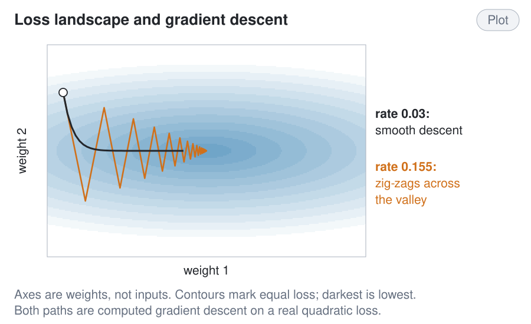

- Image search: [gradient descent loss landscape contour plot](https://www.google.com/search?tbm=isch&q=gradient+descent+loss+landscape+contour+plot)
- [Li et al., Fig. 1, PDF page 1](https://arxiv.org/pdf/1712.09913#page=1)

- **Grammar:** Plot
- **Source:** Li et al., [Visualizing the Loss Landscape of Neural Nets](https://arxiv.org/abs/1712.09913) (2018), Fig. 1.
- **Read it:** Horizontal position is a choice of weights; height is the loss there. The contour
  view is the same thing as a topographic map, seen from above.
- **Trap:** The axes are weights, not inputs. Real models have millions of weights, so every such
  picture is a low-dimensional slice, which can flatter or mislead.
- **Check:** On a contour plot, sketch the path for a learning rate that is too large. (It
  zig-zags across the valley or leaves it altogether.)

**1.9** Backpropagation: how blame flows backward to each weight (intuition + tiny worked example).

### 1.9 Computational graph and backpropagation

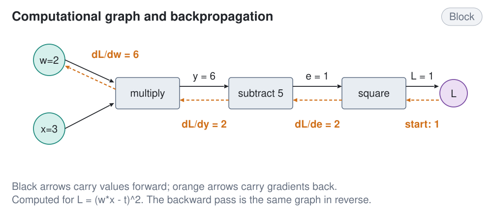

- Image search: [computational graph backpropagation diagram](https://www.google.com/search?tbm=isch&q=computational+graph+backpropagation+diagram)


- **Grammar:** Block
- **Source:** Olah, [Calculus on Computational Graphs: Backpropagation](https://colah.github.io/posts/2015-08-Backprop/) (2015).
- **Read it:** Forward arrows carry values. Backward arrows carry each output's sensitivity to
  that node, multiplied along the path by the chain rule.
- **Trap:** The backward pass is not a second network and has no weights of its own. It is the
  same graph traversed in reverse.
- **Check:** For L = (w*x - t)^2 with w = 2, x = 3, t = 5, what is dL/dw? (The error is 1, so
  2 * 1 * 3 = 6.)

```
w --\
     (*)--> y --(- t)--> e --(^2)--> L     forward: values
x --/
     <--------- dL/dw --------------       backward: gradients
```

**1.10** The training loop: epochs, batches, iterations — the whole picture.

## Phase 2 — PyTorch For Real

**2.1** Tensors: creating, shapes, indexing, math on them.

**2.2** Autograd: PyTorch computes gradients for you.

**2.3** `nn.Module`: build an MLP in code.

**2.4** Optimizers + a full training loop you write yourself.

**2.5** Datasets & DataLoaders; batching real data.

**2.6** Train/validation/test split; overfitting; what it looks like.

### 2.6 Learning curves and overfitting

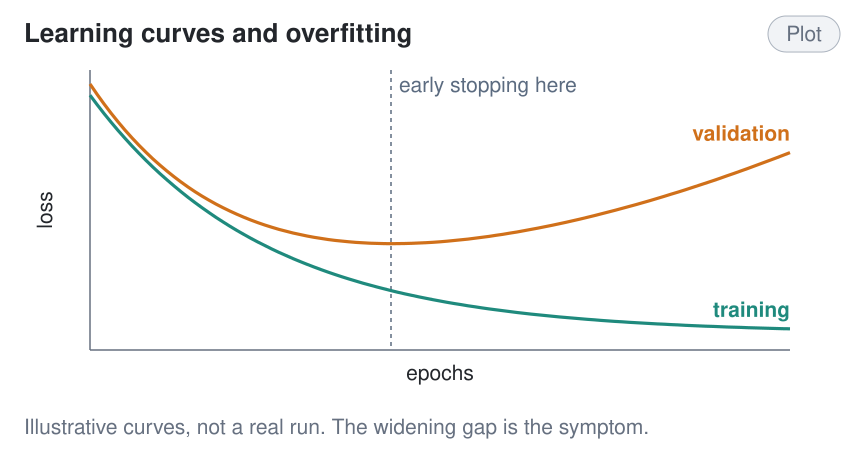

- Image search: [training validation loss curves overfitting](https://www.google.com/search?tbm=isch&q=training+validation+loss+curves+overfitting)

- **Grammar:** Plot
- **Source:** No single origin; every learner should produce their own in 2.8.
- **Read it:** Epochs across, loss up. Training loss keeps falling; validation loss falls, then
  turns back up.
- **Trap:** A low training curve alone says nothing. The widening gap is the symptom, and a
  rising validation curve is what signals overfitting.
- **Check:** Point to where early stopping would stop. (The validation minimum.)

```
loss
 |\  \___         ____ validation
 | \     \_______/
 |  \___
 |      \_________ training
 +--------------------- epochs
```

**2.7** Regularization, dropout, early stopping — keeping models honest.

### 2.7 Dropout

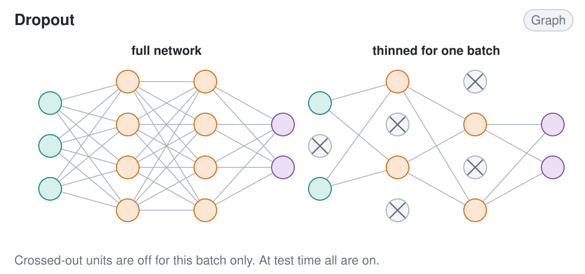

- Image search: [dropout neural network diagram](https://www.google.com/search?tbm=isch&q=dropout+neural+network+diagram)
- [Srivastava et al., Fig. 1, PDF page 2](https://jmlr.org/papers/volume15/srivastava14a/srivastava14a.pdf#page=2)

- **Grammar:** Graph
- **Source:** Srivastava et al., [Dropout](https://jmlr.org/papers/volume15/srivastava14a/srivastava14a.pdf) (2014), Fig. 1.
- **Read it:** The same network twice, the second with some units crossed out.
- **Trap:** The thinned network exists only during training, and a different one is drawn for
  each batch. At test time all units are on.
- **Check:** Why should dropout be off when you evaluate? (Otherwise predictions are randomly
  noisy, and you are testing a random subnetwork.)

**2.8** Mini-project: train an MLP to classify handwritten digits (MNIST).

## Phase 3 — Convolutional Neural Networks (Images)

**3.1** Images as tensors (height × width × channels).

### 3.1 An image as a tensor of channels

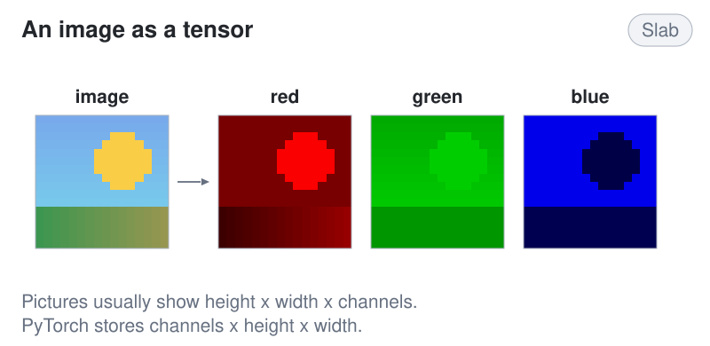

- Image search: [RGB image channels tensor diagram](https://www.google.com/search?tbm=isch&q=RGB+image+channels+tensor+diagram)

- **Grammar:** Slab
- **Source:** No single origin.
- **Read it:** Three grids stacked: red, green, blue. Together they form a 3-D block of numbers.
- **Trap:** Pictures usually show height x width x channels, while PyTorch stores channels x
  height x width.
- **Check:** What is the PyTorch shape of a batch of 8 CIFAR-10 images? (8 x 3 x 32 x 32.)

**3.2** Convolution: sliding filters, what a filter "detects" — intuition.

### 3.2 Convolution: a filter sliding over a grid

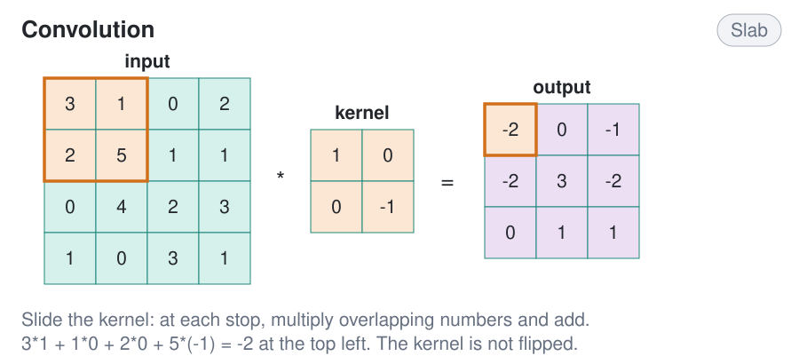

- Image search: [convolution kernel sliding over image diagram](https://www.google.com/search?tbm=isch&q=convolution+kernel+sliding+over+image+diagram)
- [Dumoulin & Visin, Fig. 1.1, PDF page 7](https://arxiv.org/pdf/1603.07285#page=7)


- **Grammar:** Slab
- **Source:** Dumoulin & Visin, [A guide to convolution arithmetic](https://arxiv.org/abs/1603.07285) (2016), Fig. 1.1, with [animations](https://github.com/vdumoulin/conv_arithmetic). Interactive: [CNN Explainer](https://poloclub.github.io/cnn-explainer/).
- **Read it:** A small window of weights slides over the input. At each stop, multiply overlapping
  numbers and add them up to get one output cell.
- **Trap:** The output is smaller or the same size, not a copy. Deep learning's "convolution" does
  not flip the kernel, so a signal-processing reader would call it correlation.
- **Check:** Apply kernel [[1, 0], [0, -1]] to patch [[3, 1], [2, 5]]. (3 - 5 = -2.)

```
input            kernel        output
3 1 0 2          1  0          -2  .  .
2 5 1 1    *     0 -1          .   .  .
0 4 2 3                        .   .  .
1 0 3 1
```

**3.3** Feature maps, stride, padding, pooling.

### 3.3 Stride, padding and pooling

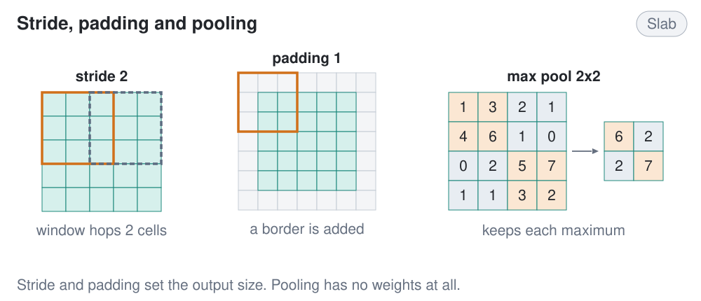

- Image search: [CNN stride padding pooling diagram](https://www.google.com/search?tbm=isch&q=CNN+stride+padding+pooling+diagram)
- [Dumoulin & Visin, Figs. 1.5 and 1.6, PDF page 11](https://arxiv.org/pdf/1603.07285#page=11)


- **Grammar:** Slab
- **Source:** Dumoulin & Visin (2016), Fig. 1.5 (average pooling), Fig. 1.6 (max pooling), and Ch. 2.
- **Read it:** Stride is how far the window hops. Padding is the border added first. Pooling is
  a window with no weights that keeps a summary, such as the maximum.
- **Trap:** Each output channel comes from its own filter, so the depth of the slab is the number
  of filters, not anything about the input.
- **Check:** Input size 5, kernel 3, padding 1, stride 2. What is the output size, using
  floor((in + 2*pad - kernel) / stride) + 1? (3.)

**3.4** Build a small CNN; train on MNIST/CIFAR-10.

### 3.4 LeNet-5 and the CNN pipeline

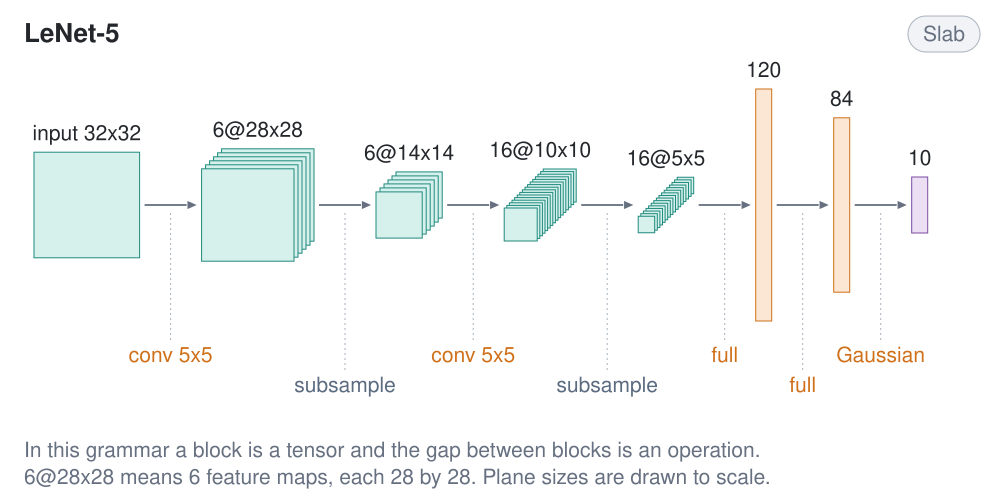

- Image search: [LeNet-5 architecture diagram](https://www.google.com/search?tbm=isch&q=LeNet-5+architecture+diagram)
- [LeCun et al., Fig. 2, PDF page 7](http://yann.lecun.com/exdb/publis/pdf/lecun-98.pdf#page=7)

- **Grammar:** Slab
- **Source:** LeCun et al., [Gradient-based learning applied to document recognition](http://yann.lecun.com/exdb/publis/pdf/lecun-98.pdf) (1998), Fig. 2.
- **Read it:** Left to right: images get smaller and deeper, then flatten into plain vectors.
  Read "6@28x28" as 6 feature maps, each 28 by 28.
- **Trap:** Each plane is a feature map, not a layer. The slanted stripes at the end are the
  fully connected layers. Nearly every later CNN picture copies this layout.
- **Check:** A 5x5 kernel with no padding turns 32x32 into what? (28x28.)

```
32x32 -> 6@28x28 -> 6@14x14 -> 16@10x10 -> 16@5x5 -> 120 -> 84 -> 10
         conv       subsample  conv        subsample full   full  Gaussian
```

**3.5** Why CNNs beat MLPs on images. Receptive fields.

### 3.5 Receptive field

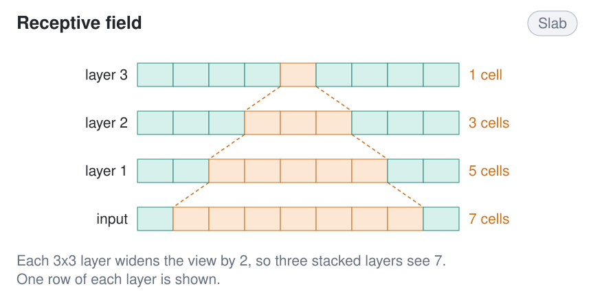

- Image search: [receptive field CNN layers diagram](https://www.google.com/search?tbm=isch&q=receptive+field+CNN+layers+diagram)
- [Zeiler & Fergus, Fig. 2, PDF page 4](https://arxiv.org/pdf/1311.2901#page=4)

- **Grammar:** Slab
- **Source:** Zeiler & Fergus, [Visualizing and Understanding Convolutional Networks](https://arxiv.org/abs/1311.2901) (2014), Fig. 2, for what each depth responds to.
- **Read it:** Pick one cell in a deep layer and trace back the cone of input pixels that can
  affect it. Each layer widens the cone.
- **Trap:** Receptive field grows with depth even when every kernel stays small. That is why deep
  layers can respond to whole objects.
- **Check:** What is the receptive field of three stacked 3x3 layers with stride 1? (7x7.)

**3.6** Transfer learning: reuse a pretrained vision model.

### 3.6 AlexNet and VGG

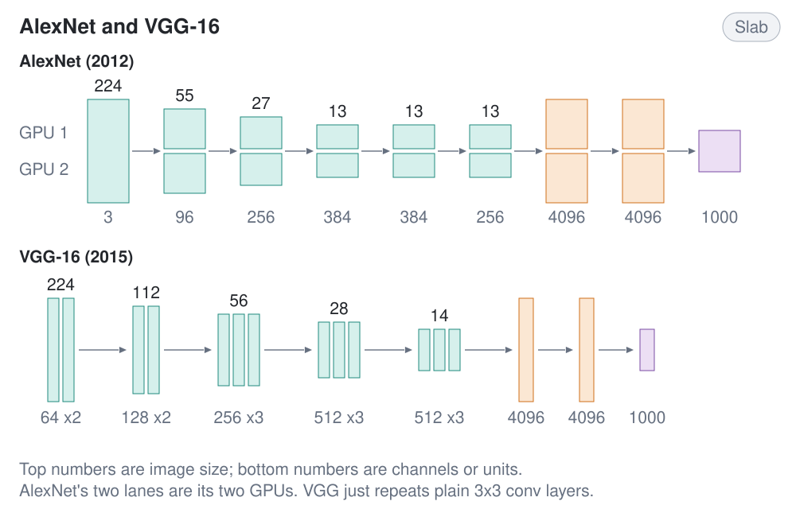

- Image search: [AlexNet architecture diagram](https://www.google.com/search?tbm=isch&q=AlexNet+architecture+diagram)
- Image search: [VGG16 architecture diagram](https://www.google.com/search?tbm=isch&q=VGG16+architecture+diagram)
- [Krizhevsky et al., Fig. 2, PDF page 5](https://proceedings.neurips.cc/paper_files/paper/2012/file/c399862d3b9d6b76c8436e924a68c45b-Paper.pdf#page=5)
- [Simonyan & Zisserman, Table 1, PDF page 3](https://arxiv.org/pdf/1409.1556#page=3)

- **Grammar:** Slab
- **Source:** Krizhevsky et al., [ImageNet Classification with Deep CNNs](https://proceedings.neurips.cc/paper_files/paper/2012/file/c399862d3b9d6b76c8436e924a68c45b-Paper.pdf) (2012), Fig. 2; Simonyan & Zisserman, [Very Deep Convolutional Networks](https://arxiv.org/abs/1409.1556) (2015), Table 1.
- **Read it:** The LeNet recipe, made much deeper and wider. VGG repeats plain 3x3 blocks.
- **Trap:** AlexNet's two parallel streams reflect two GPUs, not a design idea. The colorful VGG
  pictures online are redrawn; the paper itself gives a table.
- **Check:** Why are stacked 3x3 layers attractive? (Same receptive field as one large kernel,
  fewer weights, and more bends.)

### 3.6 Inception module

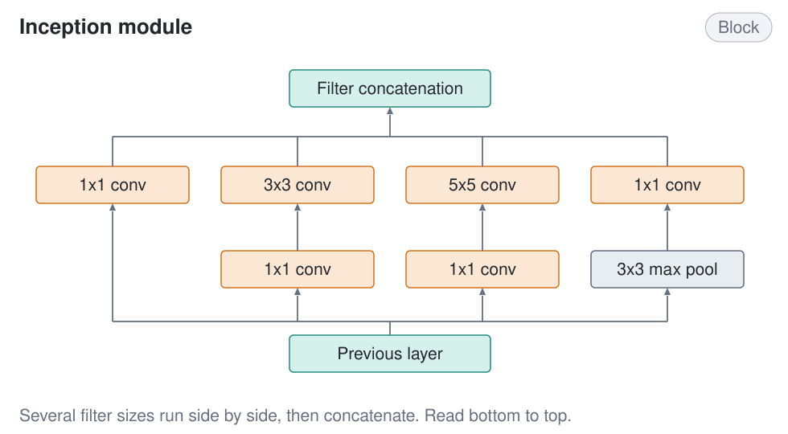

- Image search: [Inception module GoogLeNet diagram](https://www.google.com/search?tbm=isch&q=Inception+module+GoogLeNet+diagram)
- [Szegedy et al., Fig. 2, PDF page 5](https://arxiv.org/pdf/1409.4842#page=5)

- **Grammar:** Block
- **Source:** Szegedy et al., [Going deeper with convolutions](https://arxiv.org/abs/1409.4842) (2015), Fig. 2 (module), Fig. 3 (full network).
- **Read it:** Several filter sizes run side by side on the same input, and their outputs are
  concatenated.
- **Trap:** A 1x1 convolution is not a no-op: it mixes channels and shrinks the depth cheaply.
- **Check:** Why put a 1x1 before a 5x5? (To reduce channels, and so reduce computation.)

### 3.6 ResNet and the residual block

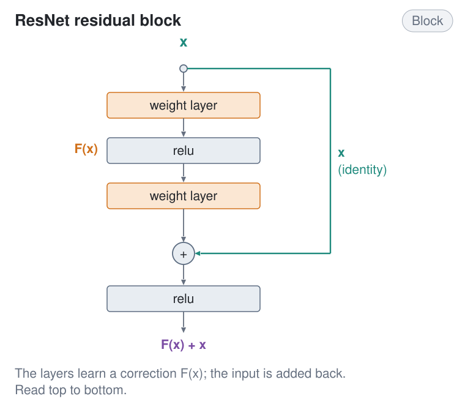

- Image search: [ResNet residual block skip connection diagram](https://www.google.com/search?tbm=isch&q=ResNet+residual+block+skip+connection+diagram)
- [He et al., Fig. 2, PDF page 2](https://arxiv.org/pdf/1512.03385#page=2)
- [He et al., Fig. 3, PDF page 4](https://arxiv.org/pdf/1512.03385#page=4)
- [Li et al., Fig. 1, PDF page 1](https://arxiv.org/pdf/1712.09913#page=1)

- **Grammar:** Block
- **Source:** He et al., [Deep Residual Learning](https://arxiv.org/abs/1512.03385) (2016), Fig. 2 (block), Fig. 3 (network); Li et al. (2018), Fig. 1, for the landscape with and without skips.
- **Read it:** Input splits in two: one path through layers, one straight across. The two are added.
- **Trap:** The layers learn the correction F(x), not the full output. The curved arrow is an
  addition, not a bypass that turns the layers off.
- **Check:** If the layers learn F(x) = 0, what does the block output? (x, unchanged, which is why
  adding depth stops hurting.)

```
x ---+--> [ layer ] -> [ layer ] --(+)--> F(x) + x
     |                              ^
     +------------------------------+
```

## Phase 4 — Sequences, Attention, Transformers

**4.1** Sequence data; turning words into numbers (embeddings).

### 4.1 Word embedding space

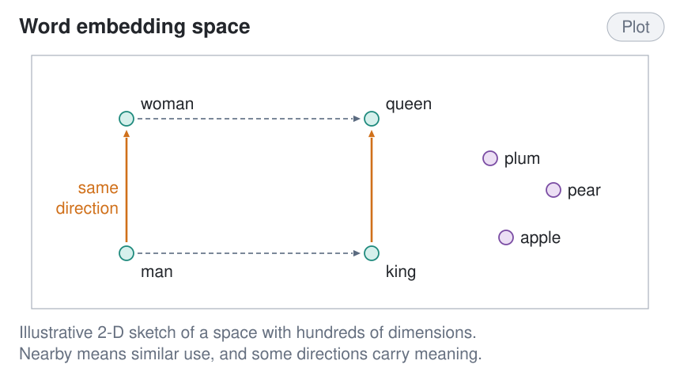

- Image search: [word embedding vector space king queen diagram](https://www.google.com/search?tbm=isch&q=word+embedding+vector+space+king+queen+diagram)
- [Mikolov et al., Fig. 1, PDF page 5](https://arxiv.org/pdf/1301.3781#page=5)

- **Grammar:** Plot
- **Source:** Mikolov et al., [Efficient Estimation of Word Representations](https://arxiv.org/abs/1301.3781) (2013), Fig. 1, shows the separate CBOW and skip-gram block pictures.
- **Read it:** Each word is a point. Nearby points mean similar usage, and some directions carry
  meaning.
- **Trap:** The 2-D plot is a projection of hundreds of dimensions, so distances are distorted,
  and the tidy king-queen parallelogram is a best case.
- **Check:** What does king - man + woman land near? (queen, approximately.)

**4.2** RNNs/LSTMs — the older way to handle sequences (brief, historical, intuition only).

### 4.2 RNN, folded and unrolled

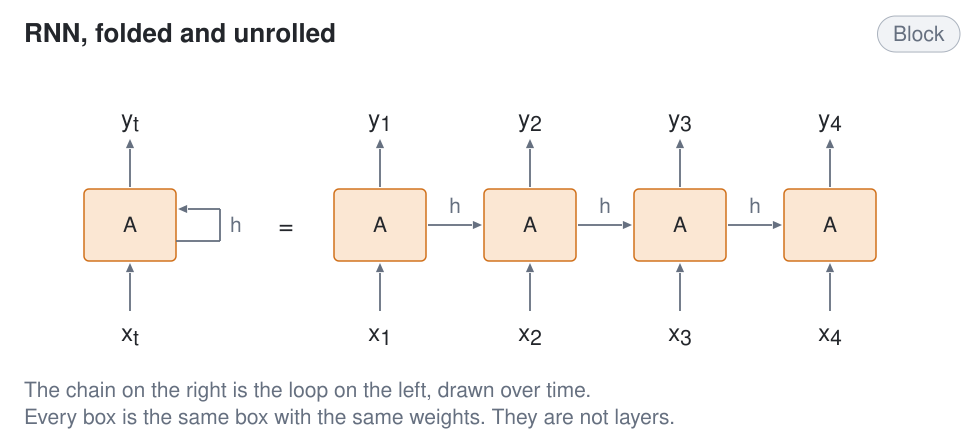

- Image search: [RNN unrolled diagram](https://www.google.com/search?tbm=isch&q=RNN+unrolled+diagram)


- **Grammar:** Block
- **Source:** Olah, [Understanding LSTM Networks](https://colah.github.io/posts/2015-08-Understanding-LSTMs/) (2015).
- **Read it:** The loop on the left and the chain on the right are the same network, drawn two ways.
- **Trap:** The repeated boxes are one box seen at different times, with shared weights. They are
  not layers.
- **Check:** How many separate sets of weights does a 5-step unrolled RNN have? (One.)

```
  +---+           x1      x2      x3
  |   |            |       |       |
x->[A]-> y   =   [A] --> [A] --> [A] -->
  ^___|            |       |       |
                  y1      y2      y3
```

### 4.2 LSTM cell

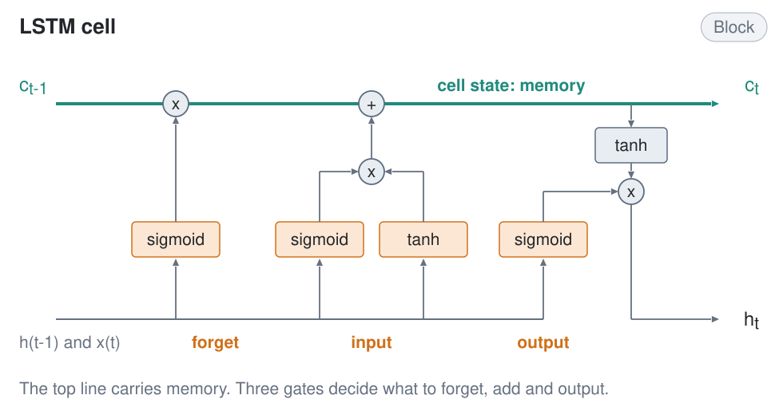

- Image search: [LSTM cell diagram](https://www.google.com/search?tbm=isch&q=LSTM+cell+diagram)


- **Grammar:** Block
- **Source:** Olah (2015).
- **Read it:** The line along the top is the cell state, a conveyor belt of memory. Gates below
  decide what to forget, what to add, and what to output.
- **Trap:** This is the scariest picture in the course and it is not worth memorizing here: 4.2
  is historical. Get the conveyor belt and the three gates. The GRU picture is a simplified cousin.
- **Check:** Which part lets information pass many steps nearly unchanged? (The cell state line.)

**4.3** The attention mechanism: "what should I focus on?" — core intuition.

### 4.3 Seq2seq (encoder-decoder)

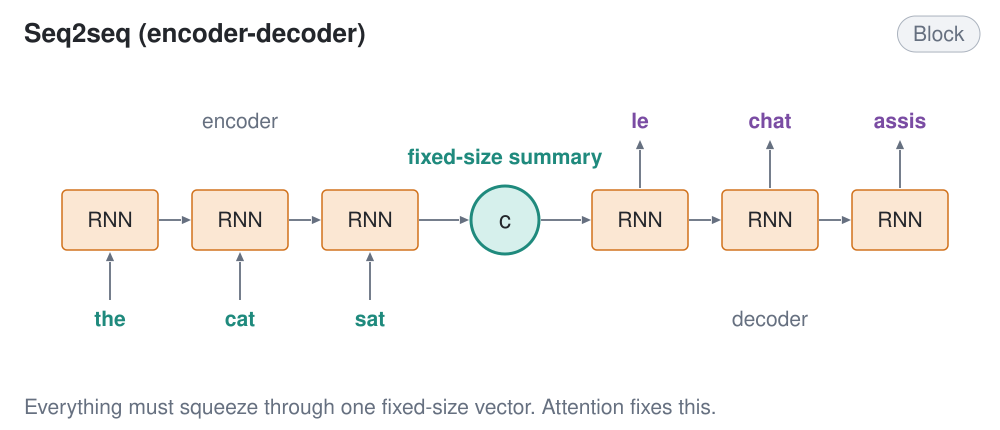

- Image search: [seq2seq encoder decoder RNN diagram](https://www.google.com/search?tbm=isch&q=seq2seq+encoder+decoder+RNN+diagram)
- [Cho et al., Fig. 1, PDF page 2](https://arxiv.org/pdf/1406.1078#page=2)

- **Grammar:** Block
- **Source:** Cho et al., [Learning Phrase Representations using RNN Encoder-Decoder](https://arxiv.org/abs/1406.1078) (2014), Fig. 1.
- **Read it:** An encoder reads the input into one summary vector, which a decoder expands into
  the output.
- **Trap:** The bottleneck is the point: everything must squeeze through one fixed-size vector,
  which is exactly the problem attention was invented to fix.
- **Check:** Why would a 50-word sentence suffer more than a 5-word one? (Same-sized summary.)

### 4.3 Attention as a heatmap

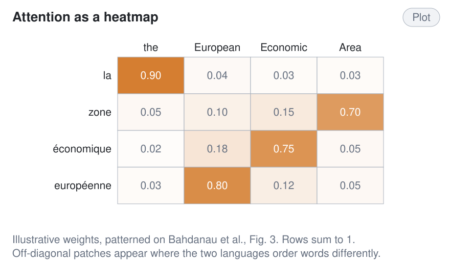

- Image search: [attention alignment heatmap translation](https://www.google.com/search?tbm=isch&q=attention+alignment+heatmap+translation)
- [Bahdanau et al., Fig. 3, PDF page 6](https://arxiv.org/pdf/1409.0473#page=6)
- [Bahdanau et al., Fig. 1, PDF page 3](https://arxiv.org/pdf/1409.0473#page=3)

- **Grammar:** Plot
- **Source:** Bahdanau et al., [Neural Machine Translation by Jointly Learning to Align and Translate](https://arxiv.org/abs/1409.0473) (2015), Fig. 3; Fig. 1 is the matching block diagram.
- **Read it:** Source words across, output words down. A bright cell means that output word looked
  at that source word.
- **Trap:** The bright diagonal isn't a rule: off-diagonal patches appear exactly where the two
  languages order words differently. The picture is a result, not an architecture.
- **Check:** What do the weights in one output word's row add up to? (1.)

**4.4** Self-attention and multi-head attention.

### 4.4 Scaled dot-product attention

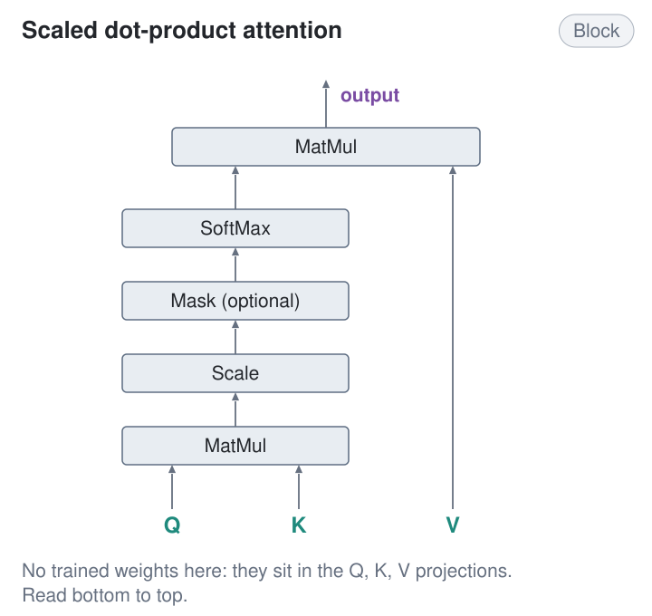

- Image search: [scaled dot-product attention query key value diagram](https://www.google.com/search?tbm=isch&q=scaled+dot-product+attention+query+key+value+diagram)
- [Vaswani et al., Fig. 2 (left), PDF page 4](https://arxiv.org/pdf/1706.03762#page=4)

- **Grammar:** Block
- **Source:** Vaswani et al., [Attention Is All You Need](https://arxiv.org/abs/1706.03762) (2017), Fig. 2 (left). Explained: Alammar, [The Illustrated Transformer](https://jalammar.github.io/illustrated-transformer/).
- **Read it:** **Bottom to top.** Queries meet keys to give scores, softmax turns scores into
  weights, and those weights mix the values.
- **Trap:** Transformer diagrams flow upward. In self-attention, Q, K and V all come from the same
  input through different learned transforms.
- **Check:** If a query matches key 2 far better than the others, what does the output mostly
  contain? (Value 2.)

```
         output
           ^
        [ MatMul ] <------ V
           ^
        [ SoftMax ]
           ^
        [ Scale ]
           ^
        [ MatMul ] <------ Q, K
```

### 4.4 Multi-head attention

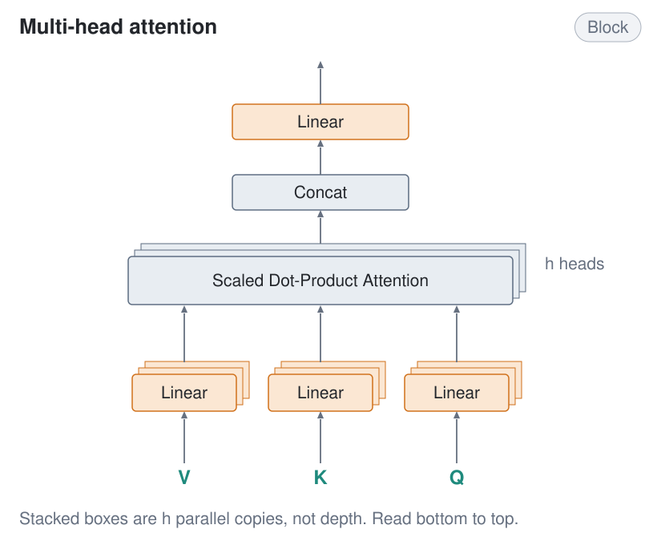

- Image search: [multi-head attention diagram](https://www.google.com/search?tbm=isch&q=multi-head+attention+diagram)
- [Vaswani et al., Fig. 2 (right), PDF page 4](https://arxiv.org/pdf/1706.03762#page=4)

- **Grammar:** Block
- **Source:** Vaswani et al. (2017), Fig. 2 (right).
- **Read it:** Several small attention units run in parallel on projected inputs. Their outputs
  are concatenated and projected again.
- **Trap:** The stacked, shadowed boxes mean parallel copies, not depth.
- **Check:** With d_model = 512 and 8 heads, how wide is each head? (64.)

**4.5** Positional encoding; residual connections; layer norm; feed-forward block.

### 4.5 Positional encoding

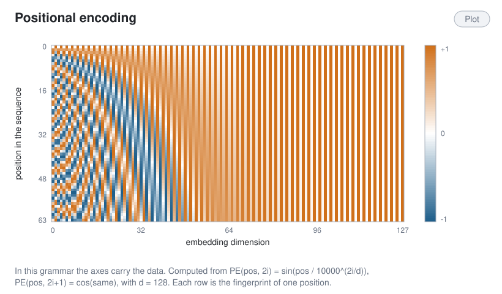

- Image search: [positional encoding heatmap transformer](https://www.google.com/search?tbm=isch&q=positional+encoding+heatmap+transformer)


- **Grammar:** Plot
- **Source:** Vaswani et al. (2017), Section 3.5, for the formula; Alammar's post above for the picture.
- **Read it:** One row per position and one column per embedding dimension. Each column is a sine
  or cosine at its own frequency, so each row is a unique fingerprint.
- **Trap:** The stripes look like signals over time, but they are a lookup table of positions,
  closer in spirit to a binary counter with fast and slow bits.
- **Check:** Why is attention alone unable to tell word order? (It treats its inputs as a set.)

### 4.5 Normalization: batch vs layer

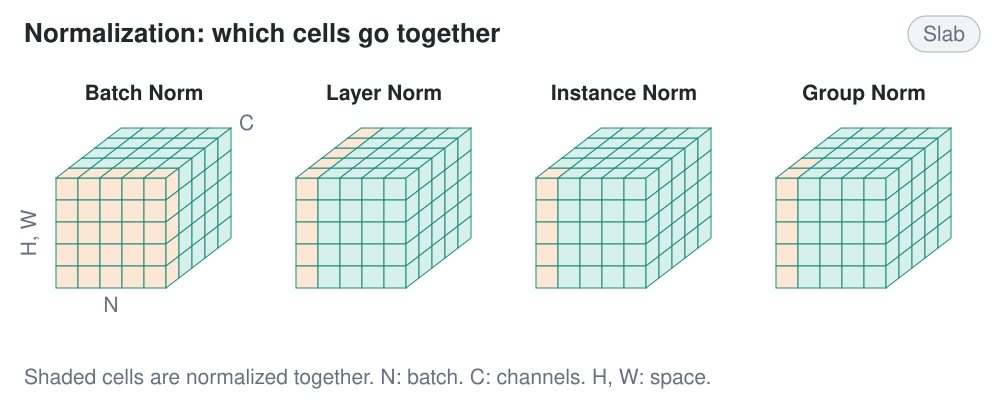

- Image search: [batch norm layer norm group norm cube diagram](https://www.google.com/search?tbm=isch&q=batch+norm+layer+norm+group+norm+cube+diagram)
- [Wu & He, Fig. 2, PDF page 3](https://arxiv.org/pdf/1803.08494#page=3)

- **Grammar:** Slab
- **Source:** Wu & He, [Group Normalization](https://arxiv.org/abs/1803.08494) (2018), Fig. 2.
- **Read it:** Each cube is a tensor with axes for batch, channels and spatial position. The
  shaded cells are the ones normalized together.
- **Trap:** The methods differ only in which axes get averaged over. Batch norm crosses examples
  in the batch; layer norm stays within one example.
- **Check:** Which one still works with a batch of size 1? (Layer norm.)

**4.6** The full **Transformer** block assembled.

### 4.6 The Transformer

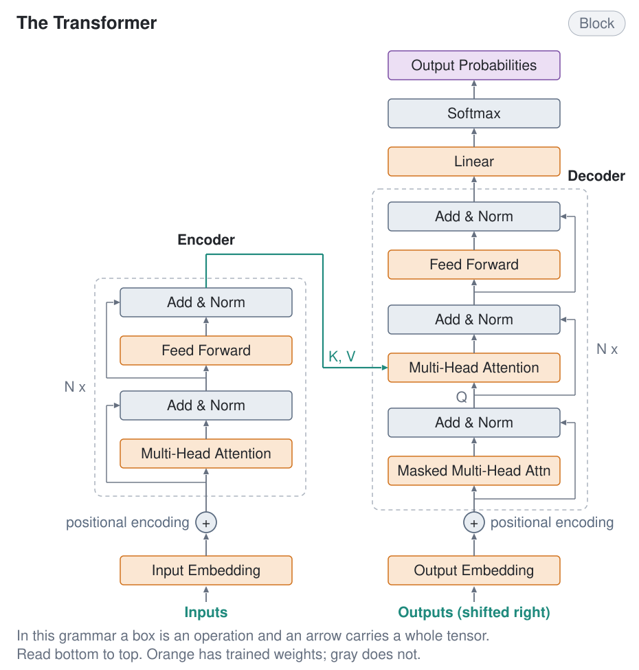

- Image search: [transformer architecture diagram attention is all you need](https://www.google.com/search?tbm=isch&q=transformer+architecture+diagram+attention+is+all+you+need)
- [Vaswani et al., Fig. 1, PDF page 3](https://arxiv.org/pdf/1706.03762#page=3)

- **Grammar:** Block
- **Source:** Vaswani et al. (2017), Fig. 1. Explained: Alammar's post above.
- **Read it:** **Bottom to top.** Left tower is the encoder, right tower the decoder, "Nx" means
  stacked N times. The arrow from left to right is cross-attention. Every arrow around an
  "Add & Norm" box is a ResNet skip.
- **Trap:** The output sits at the top, not on the right. "Outputs (shifted right)" at the bottom
  are the words produced so far. Modern LLMs keep only a version of the right tower.
- **Check:** Trace one word from Inputs to Output Probabilities and name each box it passes.

```
                        Output Probabilities
                                 ^
                       [ Linear + Softmax ]
                                 ^
 Nx +----------------+    Nx +-------------------+
    | Feed Forward   |       | Feed Forward      |
    | Multi-Head     |---+-->| Cross-Attention   |
    | Attention      |       | Masked Attention  |
    +----------------+       +-------------------+
            ^                         ^
    Inputs + position          Outputs (shifted right) + position
```

**4.7** Mini-project: build & train a tiny character-level Transformer.

## Phase 5 — Large Language Models

**5.1** Tokenization (how text becomes tokens).

**5.2** The language modeling objective: predict the next token.

### 5.2 Decoder-only stack and the causal mask (GPT)

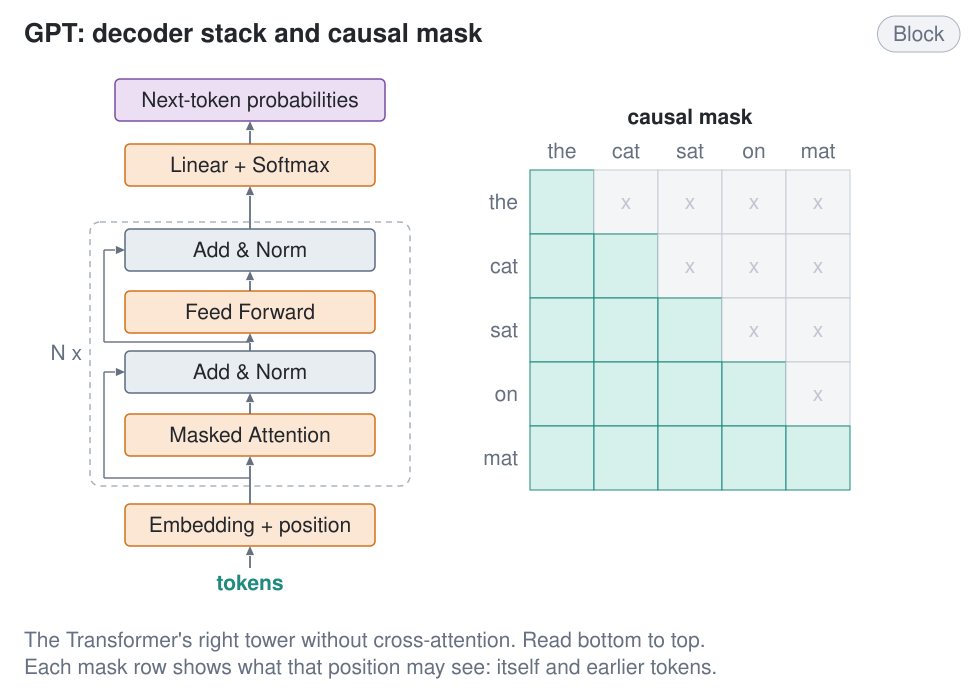

- Image search: [GPT decoder only architecture causal attention mask diagram](https://www.google.com/search?tbm=isch&q=GPT+decoder+only+architecture+causal+attention+mask+diagram)
- [Vaswani et al., Fig. 1, right tower, PDF page 3](https://arxiv.org/pdf/1706.03762#page=3)


- **Grammar:** Block
- **Source:** Alammar, [The Illustrated GPT-2](https://jalammar.github.io/illustrated-gpt2/); Vaswani et al. (2017), Fig. 1, right tower.
- **Read it:** The Transformer's right tower without its cross-attention. The triangular grid shows
  which earlier tokens each position may attend to.
- **Trap:** Masking is why training can show the model a whole sentence without letting it peek at
  the answer. The grid belongs to the model's training, not to the text.
- **Check:** In the mask below, which tokens can position 3 see? (Tokens 1 to 3.)

```
       1 2 3 4
pos 1  x . . .
pos 2  x x . .
pos 3  x x x .
pos 4  x x x x
```

**5.3** Pretraining vs fine-tuning; what "scale" buys you.

**5.4** Instruction tuning and preference tuning (RLHF) — intuition.

### 5.4 The RLHF pipeline

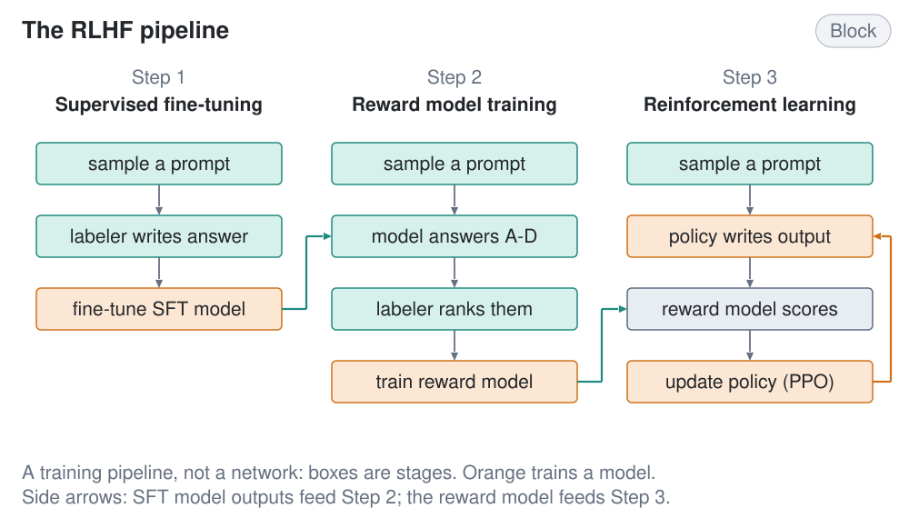

- Image search: [RLHF pipeline diagram supervised fine-tuning reward model PPO](https://www.google.com/search?tbm=isch&q=RLHF+pipeline+diagram+supervised+fine-tuning+reward+model+PPO)
- [Ouyang et al., Fig. 2, PDF page 3](https://arxiv.org/pdf/2203.02155#page=3)

- **Grammar:** Block
- **Source:** Ouyang et al., [Training language models to follow instructions](https://arxiv.org/abs/2203.02155) (2022), Fig. 2.
- **Read it:** Three stages in order: supervised fine-tuning, reward model training, then
  reinforcement learning against that reward model.
- **Trap:** This is a training pipeline, not a network architecture. Boxes are stages and models.
- **Check:** What trains the reward model? (Humans ranking the model's answers.)

**5.5** Inference: temperature, sampling, context window, prompting.

**5.6** Mini-project: load and use a small pretrained LLM (Hugging Face).

## Phase 6 — Diffusion & Generative Models

**6.1** What "generative" means; quick tour of VAEs and GANs (intuition).

### 6.1 Autoencoder

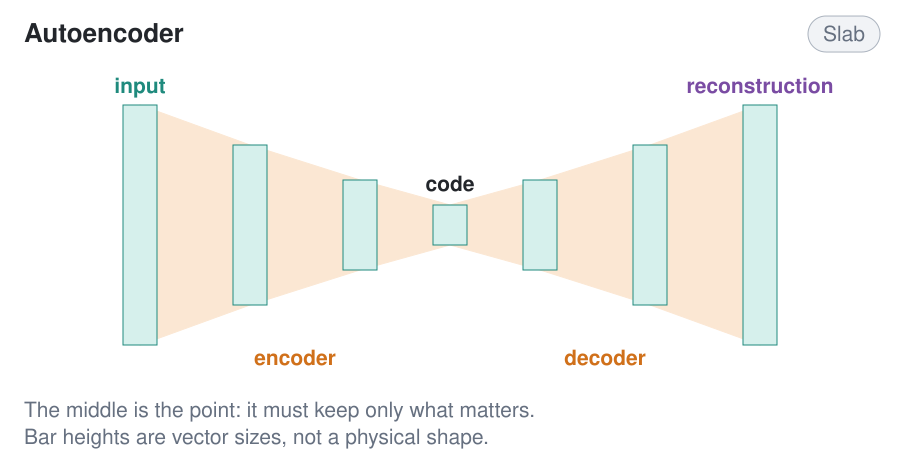

- Image search: [autoencoder bottleneck diagram](https://www.google.com/search?tbm=isch&q=autoencoder+bottleneck+diagram)

- **Grammar:** Slab
- **Source:** No single origin.
- **Read it:** Input narrows to a small code, then widens back to a reconstruction.
- **Trap:** The hourglass drawing shows vector sizes, not a physical shape. The middle is the
  whole point: it must keep only what matters.
- **Check:** What would an autoencoder with no bottleneck learn? (To copy, and nothing useful.)

```
input -> [#####] -> [###] -> [#] -> [###] -> [#####] -> reconstruction
          encoder            code    decoder
```

### 6.1 Variational autoencoder (VAE)

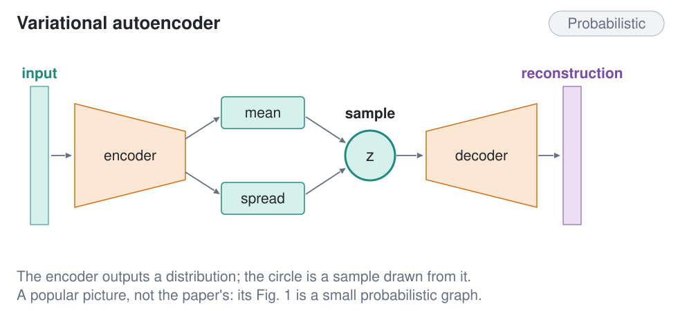

- Image search: [variational autoencoder diagram mean variance sampling](https://www.google.com/search?tbm=isch&q=variational+autoencoder+diagram+mean+variance+sampling)
- [Kingma & Welling, Fig. 1, PDF page 2](https://arxiv.org/pdf/1312.6114#page=2)

- **Grammar:** Probabilistic
- **Source:** Kingma & Welling, [Auto-Encoding Variational Bayes](https://arxiv.org/abs/1312.6114) (2013), Fig. 1.
- **Read it:** The usual picture: the encoder outputs a mean and a spread, a code is sampled from
  them, and the decoder reconstructs.
- **Trap:** That popular hourglass is not in the paper. The paper's Fig. 1 is a small probabilistic
  graph, and the difference shows why grammars matter.
- **Check:** How does a VAE's middle differ from a plain autoencoder's? (A distribution rather
  than a single point.)

### 6.1 Generative adversarial network (GAN)

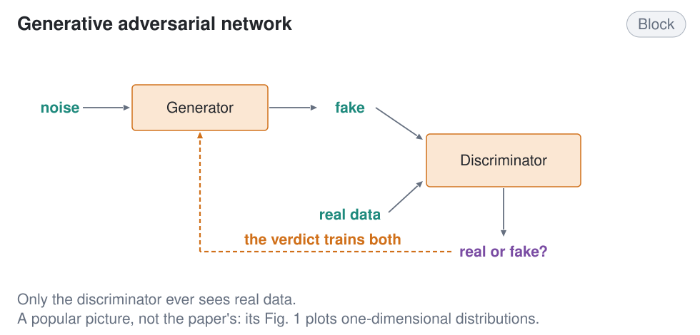

- Image search: [GAN generator discriminator diagram](https://www.google.com/search?tbm=isch&q=GAN+generator+discriminator+diagram)
- [Goodfellow et al., Fig. 1, PDF page 3](https://arxiv.org/pdf/1406.2661#page=3)

- **Grammar:** Block
- **Source:** Goodfellow et al., [Generative Adversarial Nets](https://arxiv.org/abs/1406.2661) (2014), Fig. 1.
- **Read it:** Noise feeds a generator to make a fake. A discriminator judges fakes and real
  samples, and its verdict trains both.
- **Trap:** The popular block picture is not in the paper either. The paper's Fig. 1 is a set of
  one-dimensional distribution plots showing the fake distribution moving toward the real one.
- **Check:** Which network ever sees real data directly? (Only the discriminator.)

```
noise -> [ Generator ] -> fake --\
                                  [ Discriminator ] -> real or fake?
                    real data ---/
```

**6.2** Diffusion intuition: destroy an image with noise, learn to undo it.

### 6.2 The diffusion chain

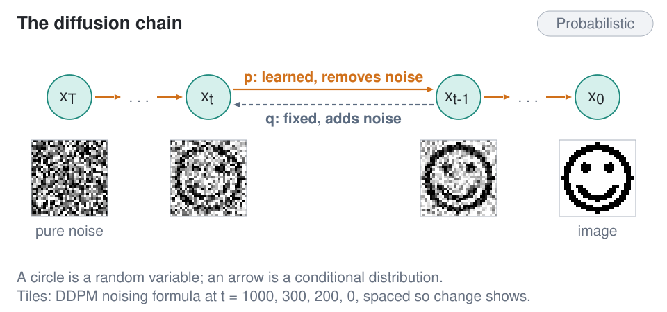

- Image search: [denoising diffusion forward reverse process diagram](https://www.google.com/search?tbm=isch&q=denoising+diffusion+forward+reverse+process+diagram)
- [Ho et al., Fig. 2, PDF page 2](https://arxiv.org/pdf/2006.11239#page=2)

- **Grammar:** Probabilistic
- **Source:** Ho et al., [Denoising Diffusion Probabilistic Models](https://arxiv.org/abs/2006.11239) (2020), Fig. 2.
- **Read it:** A chain of images from pure noise to a clean picture. One direction adds noise on
  a fixed recipe; the other removes it with a learned network.
- **Trap:** Each arrow is a probability distribution for one small step, not a network layer, and
  one single network is reused at every step.
- **Check:** Which direction needs no learning? (Adding noise.)

```
x_T  <-> ... <-> x_t  <-> x_(t-1) <-> ... <-> x_0
noise                                         image
     -- p: learned, removes noise  -->
     <-- q: fixed, adds noise       --
```

**6.3** Forward/reverse process; the denoising network (U-Net) — intuition.

### 6.3 U-Net

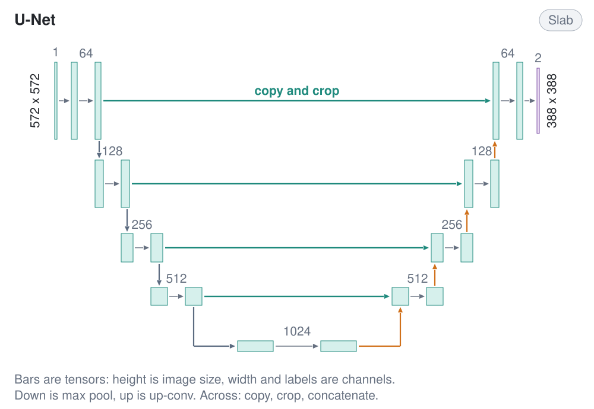

- Image search: [U-Net architecture diagram](https://www.google.com/search?tbm=isch&q=U-Net+architecture+diagram)
- [Ronneberger et al., Fig. 1, PDF page 2](https://arxiv.org/pdf/1505.04597#page=2)

- **Grammar:** Slab
- **Source:** Ronneberger et al., [U-Net](https://arxiv.org/abs/1505.04597) (2015), Fig. 1.
- **Read it:** Down the left side, images shrink and channels grow (64 up to 1024). Up the right
  side, they grow back. Gray arrows across the U copy fine detail over.
- **Trap:** The U is just a page layout. The horizontal skips are concatenated, unlike ResNet's
  addition. U-Net began in biomedical segmentation, not generation.
- **Check:** Why does the denoiser need the skips? (The bottom has context but has lost pixel
  detail, and a denoised image needs that detail.)

```
64 ---------------- copy ---------------> 64
   128 ------------ copy -----------> 128
      256 --------- copy --------> 256
         512 ------ copy -----> 512
                  1024
```

**6.4** Text-to-image conditioning; how prompts steer generation.

### 6.4 Latent diffusion (Stable Diffusion)

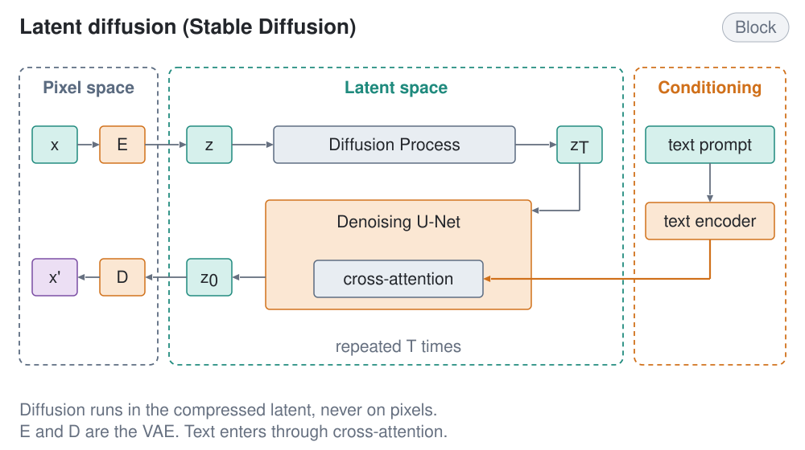

- Image search: [latent diffusion stable diffusion architecture diagram](https://www.google.com/search?tbm=isch&q=latent+diffusion+stable+diffusion+architecture+diagram)
- [Rombach et al., Fig. 3, PDF page 4](https://arxiv.org/pdf/2112.10752#page=4)

- **Grammar:** Block
- **Source:** Rombach et al., [High-Resolution Image Synthesis with Latent Diffusion Models](https://arxiv.org/abs/2112.10752) (2022), Fig. 3. Explained: Alammar, [The Illustrated Stable Diffusion](https://jalammar.github.io/illustrated-stable-diffusion/).
- **Read it:** Three regions: pixel space (a VAE encoder and decoder at the edges), latent space
  (diffusion with a U-Net in the middle), and conditioning (the text encoder feeding in).
- **Trap:** Diffusion happens in the compressed latent, never on pixels. Text enters through
  cross-attention, the same mechanism as the Transformer's left-to-right arrow.
- **Check:** Which of the earlier diagrams appear inside this one? (VAE, U-Net, the diffusion
  chain, attention.)

**6.5** Mini-project: run a small diffusion model and generate images.

## Phase 7 — Putting It Together

**7.1** How modern systems combine these pieces (multimodal, agents — overview).

### 7.1 Vision Transformer (ViT)

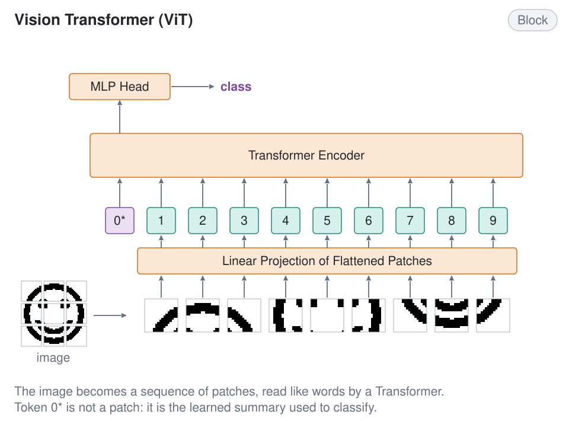

- Image search: [Vision Transformer ViT architecture diagram](https://www.google.com/search?tbm=isch&q=Vision+Transformer+ViT+architecture+diagram)
- [Dosovitskiy et al., Fig. 1, PDF page 3](https://arxiv.org/pdf/2010.11929#page=3)

- **Grammar:** Block
- **Source:** Dosovitskiy et al., [An Image is Worth 16x16 Words](https://arxiv.org/abs/2010.11929) (2021), Fig. 1.
- **Read it:** An image is cut into patches, each flattened and embedded like a word, and a standard
  Transformer encoder reads the sequence.
- **Trap:** The extra token marked 0 at the start is not a patch: it is the summary used for the
  final classification.
- **Check:** How many 16x16 patches fit in a 224x224 image? (14 * 14 = 196.)

### 7.1 CLIP

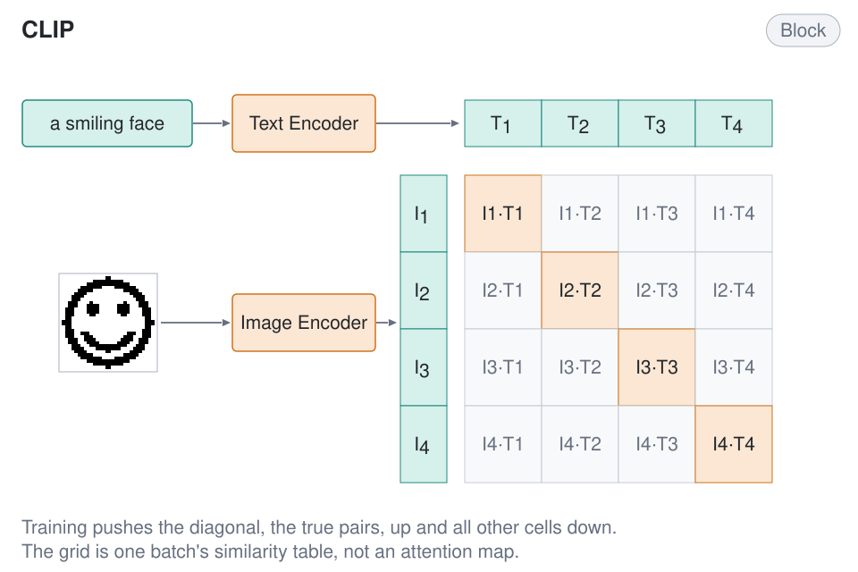

- Image search: [CLIP contrastive image text encoder diagram](https://www.google.com/search?tbm=isch&q=CLIP+contrastive+image+text+encoder+diagram)
- [Radford et al., Fig. 1, PDF page 2](https://arxiv.org/pdf/2103.00020#page=2)

- **Grammar:** Block
- **Source:** Radford et al., [Learning Transferable Visual Models From Natural Language Supervision](https://arxiv.org/abs/2103.00020) (2021), Fig. 1.
- **Read it:** An image encoder and a text encoder feed a grid of similarity scores. Training
  makes the diagonal, the true pairs, score highest.
- **Trap:** The grid is a similarity table for one batch, not an attention map.
- **Check:** In a batch of 4 pairs, how many cells should score low? (12.)

### 7.1 Agent loop

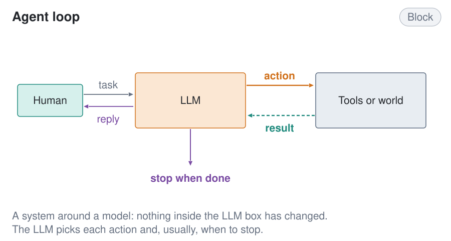

- Image search: [autonomous AI agent loop LLM tools diagram](https://www.google.com/search?tbm=isch&q=autonomous+AI+agent+loop+LLM+tools+diagram)

- **Grammar:** Block
- **Source:** Anthropic, [Building effective agents](https://www.anthropic.com/engineering/building-effective-agents) (2024), the autonomous agent figure.
- **Read it:** An LLM chooses an action, a tool or environment responds, the result returns to the
  LLM, and the loop continues until it stops.
- **Trap:** This is a system diagram around a model. Nothing inside the LLM box has changed, and
  every box from Phase 5 is still inside it.
- **Check:** What decides when the loop ends? (The LLM, or a limit set around it.)

**7.2** Capstone: pick a small project and build it with guidance.

**7.3** Where to go next: papers, courses, communities, staying current.

**7.4** The diagram wall: name, classify and trace the course's famous diagrams, unprompted.
